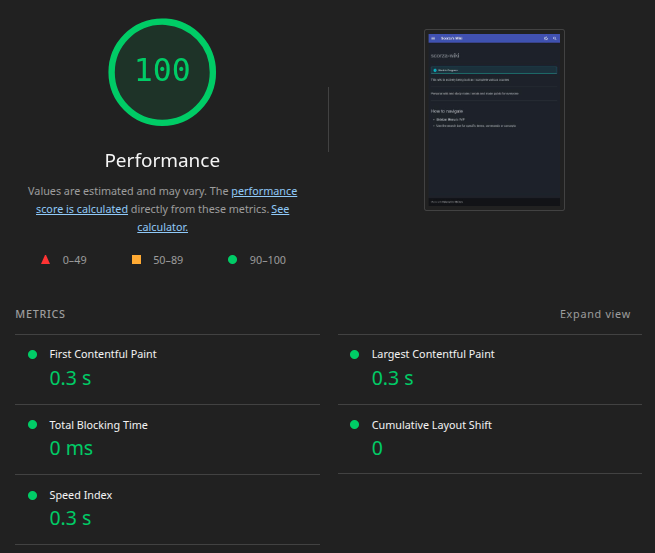

# scorza-wiki
Personal wiki and study notes I wrote and made public

## Contents
Currently archiving my study notes and lab documentation for:
* **Cisco NetAcad** 

## Infrastructure & Performance
I hate how bloated and slow the modern web has become, so I tried to make my corner as fast as possible. 
Built with a zero-bloat, docs-as-code architecture to ensure maximum rendering speed and minimal browser overhead.

* **Static Generation:** Pre-compiled via MkDocs Material. Zero server-side rendering or database queries.
* **CI/CD Pipeline:** Automated HTML minification (`mkdocs-minify-plugin`) running on GitHub Actions. CSS/JS minification when I'll add them.
* **Delivery:** Hosted on Github Pages, which use Fastly CDN with Brotli/GZip compression.
* **Performance Metrics (Throttled Mobile):**
  * **LCP & FCP:** `0.4s` (lowest: `0.3s`)
  * **Total Blocking Time (TBT):** `0ms`
  * **Cumulative Layout Shift (CLS):** `0`

<b>📊 View Lighthouse Baseline Metrics</b>

 
Performance baseline captured on initial deployment:

 
_Note: My wiki is still WIP, so these numbers are subject to change_

